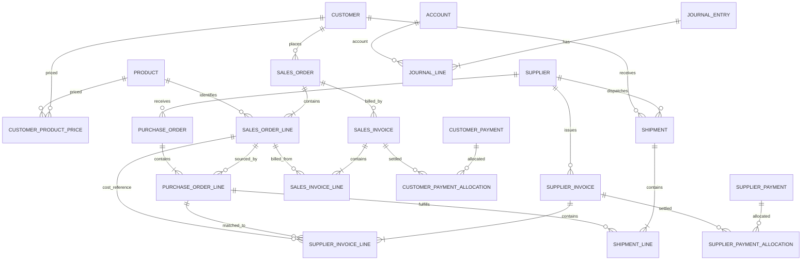

# Pemetaan Model Data dan Blueprint Integrasi — Drop-Ship

**Diperbarui:** 16 Oktober 2026
**Status:** blueprint konseptual untuk review; belum menjadi skema fisik atau migrasi.
**Menggantikan:** blueprint lama yang mengasumsikan penerimaan stok, batch, FEFO, dan inventaris. Semua asumsi stok fisik dinyatakan tidak berlaku.

## 1. Prinsip domain

Jena tidak memiliki gudang atau stok fisik pada sistem. Supplier mengirim langsung kepada pelanggan. Sumber referensi transaksi adalah customer, supplier, product, dan harga jual efektif per pasangan customer-product. Snapshot harga, satuan, diskon, pajak, alamat kirim, serta nilai biaya supplier disimpan pada dokumen agar perubahan master tidak mengubah histori.

Alur utama: `sales_order` → satu atau beberapa `purchase_order` → `supplier_invoice` → `shipment` langsung supplier ke pelanggan → `sales_invoice` → customer/supplier payments dan allocations → `journal_entry`/`journal_line`.

## 2. Pemetaan layar ke entitas

| Layar | Entitas konseptual | Aturan inti |
|---|---|---|
| Dashboard | Read model dari SO/PO/invoice/shipment/payment/journal | Tidak menyimpan transaksi; tunjukkan periode, waktu pembaruan, serta label aktual/demo. Tidak ada KPI stok. |
| Pelanggan | `customer`, `customer_contact`, `customer_product_price` | Kode unik, alamat kirim, kontak/WA, NPWP opsional, termin, limit kredit, status aktif. |
| Supplier | `supplier`, `supplier_contact`, `supplier_bank_account` | Status PKP, termin, rekening, status aktif. |
| Barang | `product`, `product_unit`, `product_category` | Kode dan satuan; tidak ada saldo stok atau batch. |
| Harga per Pelanggan | `customer_product_price` dan versi/masa berlaku | Harga jual efektif per pelanggan+barang, riwayat; snapshot di SO. Modal supplier terakhir hanya pembanding. |
| Pesanan Pelanggan | `sales_order`, `sales_order_line` | Harga default dari harga khusus, override dapat dicatat, snapshot harga/discount/tax; belum otomatis pendapatan/cash. |
| Order ke Supplier | `purchase_order`, `purchase_order_line` | Dibuat dari SO; split supplier didukung. Setiap line melacak SO-line. Alamat ship-to pelanggan wajib. PO tidak menambah stok. |
| Faktur Supplier | `supplier_invoice`, `supplier_invoice_line` | Nomor unik per supplier; faktur aktual ditautkan ke PO/line. PPN masukan terpisah; diskon faktur dialokasikan secara eksplisit ke modal aktual. |
| Pengiriman | `shipment`, `shipment_line`, `shipment_status_event` | Supplier adalah pengirim, customer tujuan; lacak tanggal, resi/surat jalan, line dan kuantitas. Tidak ada penerimaan gudang. |
| Invoice Pelanggan | `sales_invoice`, `sales_invoice_line`, `tax_transaction_line` | Nomor berurutan, harga snapshot, diskon, PPN keluaran; sumber kuantitas/trigger invoice perlu dipastikan. PDF/WA adalah attachment/link/delivery event terpisah. |
| Pembayaran | `customer_payment`, `customer_payment_allocation`, `supplier_payment`, `supplier_payment_allocation` | Pembayaran parsial dan multi-alokasi; metode, tanggal, rekening, bukti. Uang muka/kelebihan dicatat sebagai kredit terpisah, bukan memaksa alokasi. |
| Akuntansi | `account`, `posting_rule`, `journal_entry`, `journal_line`, `accounting_period` | Jurnal balance, posting atomik/idempoten, posted tidak dihapus; koreksi melalui reversal/adjustment dengan audit. |
| Audit & dokumen | `audit_event`, `attachment`, `attachment_link`, `idempotency_key`, `document_sequence` | Aksi sensitif dapat ditelusuri; rahasia tidak disimpan pada audit. |

## 3. ERD konseptual

Diagram ini konseptual. Pengiriman dan invoice parsial/multi-supplier perlu line-level foreign keys serta batas unik/quantity agregat agar tidak mengirim atau menagih dua kali. Pilihan pemodelan tax, account dan journal harus diuji terhadap aturan bisnis yang disepakati.

## 4. Aturan konsistensi dan keamanan yang harus dirancang

- Unique document numbers: SO/PO/sales invoice/payment berurutan; supplier invoice unik per supplier.
- Snapshot: sales price, supplier cost, unit, discount, tax rate, destination dan due term tidak berubah setelah transaksi diposting.
- Split PO: PO line menjaga referensi ke satu sales order line; kuantitas gabungan PO/shipment tidak melampaui jumlah SO tanpa override tercatat.
- Direct delivery: shipment wajib supplier dan alamat pelanggan; tidak menulis tabel stok.
- Invoice: kebijakan quantity/trigger faktur perlu disepakati; jangan membuat penagihan ganda atas SO line.
- Payments: alokasi total <= payment available dan <= invoice outstanding; dukung banyak invoice dan cicilan dengan proteksi concurrency.
- Journal: validasi debit=kredit; posting satu transaksi atomik dan idempotent; periode tutup tidak dapat dimutasi biasa.
- Auth: server-side role checks dan RLS untuk Owner/Admin/Viewer; UI-only hiding tidak memadai.
- Audit: rekam user/time/action/old-new/reason bagi perubahan sensitif; dokumen final dibatalkan dengan reversal/void yang terlacak.

## 5. Keputusan akuntansi dan pajak yang masih terbuka

1. Status PKP, profil pajak, jenis transaksi kena pajak, tarif efektif dan aturan rounding perlu diverifikasi.
2. Tentukan kapan AP dan modal aktual dicatat jika supplier invoice diterima sebelum shipment.
3. Tentukan titik pengakuan pendapatan dan HPP pada transaksi direct delivery: pengiriman supplier, bukti pelanggan menerima, atau aturan lain.
4. Tentukan apakah invoice pelanggan dapat diterbitkan per shipment parsial atau hanya setelah keseluruhan SO selesai.
5. Tetapkan perlakuan diskon total, ongkos kirim, supplier credit/retur, selisih kuantitas, uang muka, PPN masukan/keluaran dan jurnal reversal.
6. COA awal ada dalam dokumen Fase 0; pemetaan final harus ditinjau pemilik/akuntan.

## 6. Urutan integrasi yang diusulkan

1. Review domain, aturan pajak, pengakuan dan COA; konfirmasi target Supabase sebagai dev/test atau produksi.
2. Buat migrasi awal hanya setelah desain fisik, role/RLS, backup/rollback dan approval migrasi siap.
3. Implementasi autentikasi/otorisasi dan master customer, supplier, product, price history serta account.
4. Implementasi SO dan PO supplier split, validasi batas kuantitas, alamat tujuan dan nomor dokumen.
5. Implementasi supplier invoice, perhitungan diskon/PPN/modal aktual dan supplier payment allocation.
6. Implementasi shipment langsung, sales invoice, PDF/WA link dan customer payment allocation.
7. Implementasi posting jurnal dan laporan berbasis ledger; audit, close period, ekspor dan dashboard.
8. Uji end-to-end cash/credit, split supplier, partial ship/invoice/payment, margin negatif, pajak, reversal, role, backup/restore.

## 7. Status lingkungan database

Pada inspeksi read-only 16 Oktober 2026, Supabase `Jena Medical Center` (`sjiezdyxylwvqessyvml`) berstatus aktif dan schema `public` kosong. Tidak ada migrasi/schema/data yang dibuat sebagai bagian dari refaktor UI. Blueprint ini bukan izin mengubah schema; implementasi database dimulai setelah keputusan pada bagian 5 dan target environment disepakati.
