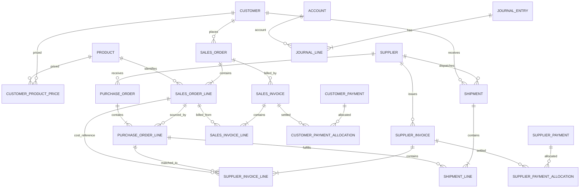

# Pemetaan Model Data dan Blueprint Integrasi — Drop-Ship

**Diperbarui:** 16 Oktober 2026
**Status:** blueprint konseptual; SO/PO, harga khusus pelanggan, capture-only Faktur Supplier, dan shipment langsung telah diterapkan bertahap. Lihat bagian 8, 10, 12, dan 13 untuk cakupannya.
**Menggantikan:** blueprint lama yang mengasumsikan penerimaan stok, batch, FEFO, dan inventaris. Semua asumsi stok fisik dinyatakan tidak berlaku.

## 1. Prinsip domain

Jena tidak memiliki gudang atau stok fisik pada sistem. Supplier mengirim langsung kepada pelanggan. Sumber referensi transaksi adalah customer, supplier, product, dan harga jual efektif per pasangan customer-product. Snapshot harga, satuan, diskon, pajak, alamat kirim, serta nilai biaya supplier disimpan pada dokumen agar perubahan master tidak mengubah histori.

Alur utama: `sales_order` → satu atau beberapa `purchase_order` → `supplier_invoice` → `shipment` langsung supplier ke pelanggan → `sales_invoice` → customer/supplier payments dan allocations → `journal_entry`/`journal_line`.

## 2. Pemetaan layar ke entitas

| Layar | Entitas konseptual | Aturan inti |
|---|---|---|
| Dashboard | Read model dari SO/PO/invoice/shipment/payment/journal | Tidak menyimpan transaksi; tunjukkan periode, waktu pembaruan, serta label aktual/demo. Tidak ada KPI stok. |
| Pelanggan | `customer`, `customer_contact`, `customer_product_price` | Kode unik, alamat kirim, kontak/WA, NPWP opsional, termin, limit kredit, status aktif. |
| Supplier | `supplier`, `supplier_contact`, `supplier_bank_account` | Status PKP, termin, rekening, status aktif. |
| Barang | `product`, `product_unit`, `product_category` | Kode dan satuan; tidak ada saldo stok atau batch. |
| Harga per Pelanggan | `customer_product_price` dan versi/masa berlaku | Harga jual efektif per pelanggan+barang, riwayat; snapshot di SO. Modal supplier terakhir hanya pembanding. |
| Pesanan Pelanggan | `sales_order`, `sales_order_line` | Harga default dari harga khusus, override dapat dicatat, snapshot harga/discount/tax; belum otomatis pendapatan/cash. |
| Order ke Supplier | `purchase_order`, `purchase_order_line` | Dibuat dari SO; split supplier didukung. Setiap line melacak SO-line. Alamat ship-to pelanggan wajib. PO tidak menambah stok. |
| Faktur Supplier | `supplier_invoice`, `supplier_invoice_line` | Nomor unik per supplier; faktur aktual ditautkan ke PO/line. PPN masukan terpisah; diskon faktur dialokasikan secara eksplisit ke modal aktual. |
| Pengiriman | `shipment`, `shipment_line`, `shipment_status_event` | Supplier adalah pengirim, customer tujuan; lacak tanggal, resi/surat jalan, line dan kuantitas. Tidak ada penerimaan gudang. |
| Invoice Pelanggan | `sales_invoice`, `sales_invoice_line`, `tax_transaction_line` | Nomor berurutan, harga snapshot, diskon, PPN keluaran; sumber kuantitas/trigger invoice perlu dipastikan. PDF/WA adalah attachment/link/delivery event terpisah. |
| Pembayaran | `customer_payment`, `customer_payment_allocation`, `supplier_payment`, `supplier_payment_allocation` | Pembayaran parsial dan multi-alokasi; metode, tanggal, rekening, bukti. Uang muka/kelebihan dicatat sebagai kredit terpisah, bukan memaksa alokasi. |
| Akuntansi | `account`, `posting_rule`, `journal_entry`, `journal_line`, `accounting_period` | Jurnal balance, posting atomik/idempoten, posted tidak dihapus; koreksi melalui reversal/adjustment dengan audit. |
| Audit & dokumen | `audit_event`, `attachment`, `attachment_link`, `idempotency_key`, `document_sequence` | Aksi sensitif dapat ditelusuri; rahasia tidak disimpan pada audit. |

## 3. ERD konseptual

Diagram ini konseptual. Pengiriman dan invoice parsial/multi-supplier perlu line-level foreign keys serta batas unik/quantity agregat agar tidak mengirim atau menagih dua kali. Pilihan pemodelan tax, account dan journal harus diuji terhadap aturan bisnis yang disepakati.

## 4. Aturan konsistensi dan keamanan yang harus dirancang

- Unique document numbers: SO/PO/sales invoice/payment berurutan; supplier invoice unik per supplier.
- Snapshot: sales price, supplier cost, unit, discount, tax rate, destination dan due term tidak berubah setelah transaksi diposting.
- Split PO: PO line menjaga referensi ke satu sales order line; kuantitas gabungan PO/shipment tidak melampaui jumlah SO tanpa override tercatat.
- Direct delivery: shipment wajib supplier dan alamat pelanggan; tidak menulis tabel stok.
- Invoice: kebijakan quantity/trigger faktur perlu disepakati; jangan membuat penagihan ganda atas SO line.
- Payments: alokasi total <= payment available dan <= invoice outstanding; dukung banyak invoice dan cicilan dengan proteksi concurrency.
- Journal: validasi debit=kredit; posting satu transaksi atomik dan idempotent; periode tutup tidak dapat dimutasi biasa.
- Auth: server-side role checks dan RLS untuk Owner/Admin/Viewer; UI-only hiding tidak memadai.
- Audit: rekam user/time/action/old-new/reason bagi perubahan sensitif; dokumen final dibatalkan dengan reversal/void yang terlacak.

## 5. Keputusan akuntansi dan pajak yang masih terbuka

1. Status PKP, profil pajak, jenis transaksi kena pajak, tarif efektif dan aturan rounding perlu diverifikasi.
2. Tentukan kapan AP dan modal aktual dicatat jika supplier invoice diterima sebelum shipment.
3. Tentukan titik pengakuan pendapatan dan HPP pada transaksi direct delivery: pengiriman supplier, bukti pelanggan menerima, atau aturan lain.
4. Tentukan apakah invoice pelanggan dapat diterbitkan per shipment parsial atau hanya setelah keseluruhan SO selesai.
5. Tetapkan perlakuan diskon total, ongkos kirim, supplier credit/retur, selisih kuantitas, uang muka, PPN masukan/keluaran dan jurnal reversal.
6. COA awal ada dalam dokumen Fase 0; pemetaan final harus ditinjau pemilik/akuntan.

## 6. Urutan integrasi yang diusulkan

1. Review domain, aturan pajak, pengakuan dan COA; konfirmasi target Supabase sebagai dev/test atau produksi.
2. Buat migrasi awal hanya setelah desain fisik, role/RLS, backup/rollback dan approval migrasi siap.
3. Implementasi autentikasi/otorisasi dan master customer, supplier, product, price history serta account.
4. Implementasi SO dan PO supplier split, validasi batas kuantitas, alamat tujuan dan nomor dokumen.
5. Capture faktur supplier dari dokumen sumber telah dimulai; lanjutkan validasi pajak/PPN, alokasi diskon ke modal aktual, AP dan pembayaran setelah kebijakan disepakati.
6. Shipment langsung sudah diimplementasikan; lanjutkan sales invoice dan customer payment allocation setelah trigger invoice, pajak dan aturan posting disepakati.
7. Implementasi posting jurnal dan laporan berbasis ledger; audit, close period, ekspor dan dashboard.
8. Uji end-to-end cash/credit, split supplier, partial ship/invoice/payment, margin negatif, pajak, reversal, role, backup/restore.

## 7. Status lingkungan database

Per 17 Oktober 2026, Supabase `Jena Medical Center` (`sjiezdyxylwvqessyvml`) berstatus aktif. Lima migration telah diterapkan untuk SO/PO, harga khusus pelanggan, capture Faktur Supplier, dan shipment; 13 tabel ber-RLS dan tidak berisi data. Cakupan serta batasnya dijelaskan pada bagian 8, 10, 12, dan 13; pajak dan akuntansi tetap memerlukan keputusan sebelum posting.

## 8. Status implementasi fase pertama (16 Oktober 2026)

Blueprint tahap awal diterapkan pada Supabase project `Jena Medical Center` melalui migration `20261016125928_dropship_suppliers_orders` dan `20261016130021_dropship_foreign_key_indexes`. Tabel fisik: `customers`, `suppliers`, `products`, `sales_orders`, `sales_order_lines`, `purchase_orders`, dan `purchase_order_lines`. Seluruh tabel memakai RLS dan masih kosong; tidak ada data contoh atau tabel persediaan.

Alur UI yang telah tersambung: login Supabase Auth, master Pelanggan/Supplier/Barang, pembuatan dan konfirmasi SO, serta pembuatan draft PO supplier dari SO terkonfirmasi. Rincian kebijakan role, RPC, advisor dan environment ada di `SUPABASE_INTEGRATION.md`.

**Batas fase ini:** mata uang IDR; SO belum menghitung PPN/jurnal; Faktur Supplier hanya capture raw values dan belum mengakui AP/HPP atau pembayaran. Shipment, sales invoice, pembayaran, audit dan lampiran belum dibuat. Jangan menganggap blueprint seluruh siklus akuntansi telah selesai.

## 9. Langkah berikutnya

1. Administrator memprovisikan akun Supabase Auth dan menetapkan claim role tepercaya `app_metadata.business_role`; lakukan uji Owner/Admin/Viewer.
2. Tinjau manual snapshot, SO/PO dan kuantitas split melalui satu transaksi non-produksi.
3. Uji customer-product price history bersama pemilik; finalisasi tax/PPN, termin dan COA bersama pemilik/akuntan.
4. Uji shipment dengan PO split/parsial setelah data master tersedia. Modul transaksi berikutnya adalah sales invoice; sepakati kapan invoice diterbitkan untuk pengiriman parsial sebelum membuat posting, payments/allocations, audit log dan jurnal idempotent.
5. Tambahkan test concurrency, backup/restore, audit dan reversal sebelum rilis produksi.

## 10. Tahap kedua — harga khusus pelanggan (16 Oktober 2026)

Migration `20261016132858_customer_product_price_history` menambahkan `customer_product_prices`, referensi rate pada `sales_order_lines.customer_product_price_id`, dan flag `price_overridden`. Harga khusus per customer-product memakai rentang tanggal efektif, IDR dan catatan opsional. RLS memungkinkan baca role bisnis; penetapan rate hanya melalui RPC Owner/Admin. Versi baru menutup rate terbuka sehari sebelumnya dan tidak boleh backdated atau mengganti versi di tanggal yang sama.

SO memilih harga yang berlaku pada tanggal SO secara default. Bila rate dipilih, server memvalidasi customer, product dan tanggal lalu menyimpan snapshot harga serta ID rate. Admin dapat mengubah harga manual; server menandai baris sebagai override dan tetap menyimpan harga sebagai snapshot. Perubahan rate tidak mengubah SO lama.

Semua tarif masih **pra-pajak**. Tahap harga tidak menentukan status PKP, PPN, pembulatan, atau jurnal. Sepuluh tabel Supabase tetap kosong; akun uji ber-role dan data master belum diprovisikan.

## 11. Batas operasional setelah tahap harga

- Uji harga berlaku, rate terjadwal, pergantian rate, SO yang memakai rate, dan override manual setelah akun ber-role tersedia.
- Koreksi historis/backdate atau mengganti versi pada tanggal yang sama belum didukung; jangan menghapus riwayat lewat SQL untuk memperbaikinya.
- Capture draft Faktur Supplier dan shipment langsung sudah tersedia. Langkah transaksi berikutnya adalah sales invoice; keputusan pajak/PPN, COA, alokasi diskon/ongkos, serta titik pengakuan HPP/pendapatan/AP tetap memerlukan pemilik/akuntan.

## 12. Tahap ketiga — capture Faktur Supplier (16 Oktober 2026)

Migration `20261016134859_supplier_invoice_capture` menambahkan `supplier_invoices` dan `supplier_invoice_lines`. Header menyimpan nomor faktur unik per supplier (case/trim-insensitive), tanggal, tempo, status/mode pajak, tarif yang tercetak, tipe/nilai diskon, subtotal, PPN, biaya lain, total, catatan, dan status `draft`/`void`. Baris menyimpan kuantitas dan nominal sesuai dokumen serta snapshot produk yang ditautkan ke PO-line non-dibatalkan milik supplier yang sama.

Semua tabel ber-RLS; data hanya bisa dibuat lewat RPC Owner/Admin `create_supplier_invoice`. Draft hanya dapat di-void melalui `void_supplier_invoice` dengan alasan, pengguna, dan waktu; data tidak dihapus. Viewer dapat membaca. Semua sepuluh tabel masih kosong.

**Batas penting:** capture ini bukan posting akuntansi. Tarif 11% hanya nilai awal dari brief untuk faktur supplier berstatus PKP dan bukan penetapan hukum atau hasil perhitungan pajak. Sistem tidak menghitung PPN/total, tidak mengalokasikan diskon/ongkos ke HPP, tidak mengakui hutang, tidak mencatat pembayaran/jurnal, dan belum membatasi kuantitas faktur kumulatif terhadap PO. Periksa faktur asli dan semua selisih secara manual sampai aturan bisnis disepakati.

## 13. Tahap keempat — shipment langsung supplier-ke-pelanggan (17 Oktober 2026)

Migration `20261016171001_dropship_shipment_tracking` menambahkan `shipments`, `shipment_lines`, dan `shipment_status_events`, serta metadata `sent_at/sent_by` dan `acknowledged_at/acknowledged_by` pada PO. Owner/Admin menandai PO terkirim lalu mencatat konfirmasi supplier secara manual; sistem tidak mengirim dokumen atau email.

Shipment hanya dapat dibuat dari PO yang sudah berstatus `sent` atau `acknowledged`. Header mengambil supplier, customer, SO dan alamat tujuan dari snapshot PO. Baris mengacu ke PO-line, menyimpan snapshot item, dan mendukung pengiriman parsial. RPC mengunci PO/line dan menghitung kuantitas pada shipment draft/non-batal untuk mencegah overship; pembatalan draft melepaskan kuantitas. Semua tabel ber-RLS, hanya dapat ditulis lewat RPC Owner/Admin, dan seluruh 13 tabel tetap kosong.

Status yang dicatat: `draft`, `shipped`, `delivered`, `issue`, dan `cancelled`. Timeline menyimpan perubahan, tanggal, catatan, pengguna dan waktu pencatatan. Draft dapat dibatalkan dengan alasan; shipment yang sudah dikirim tidak dapat dibatalkan lewat alur ini. Shipment tidak membuat penerimaan, invoice pelanggan, hutang/AP, HPP, pajak, pembayaran atau jurnal. Belum ada integrasi kurir, upload bukti, akun uji/data bisnis, maupun uji UI end-to-end; sales invoice menjadi tahap berikutnya setelah kebijakan penerbitannya disepakati.
